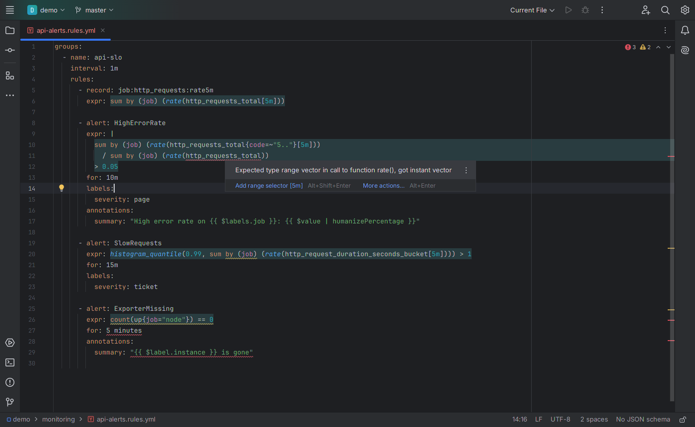
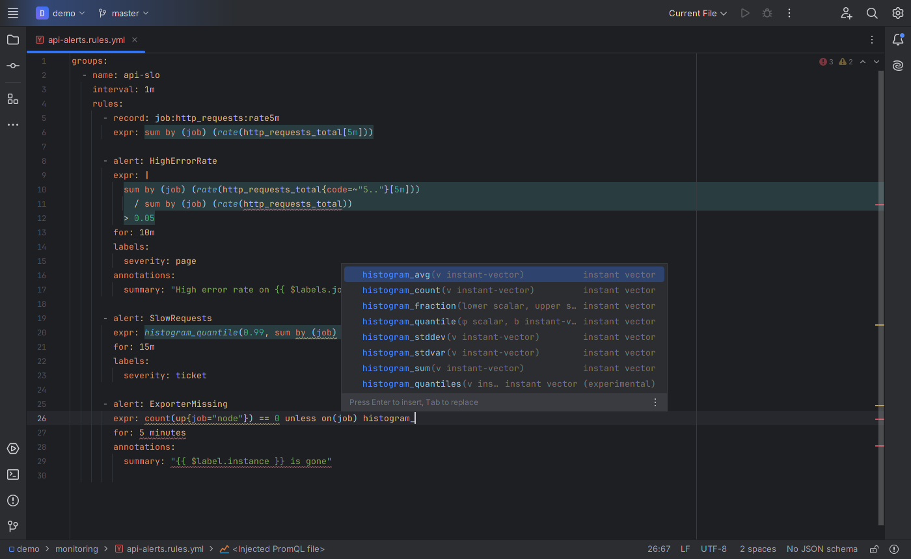
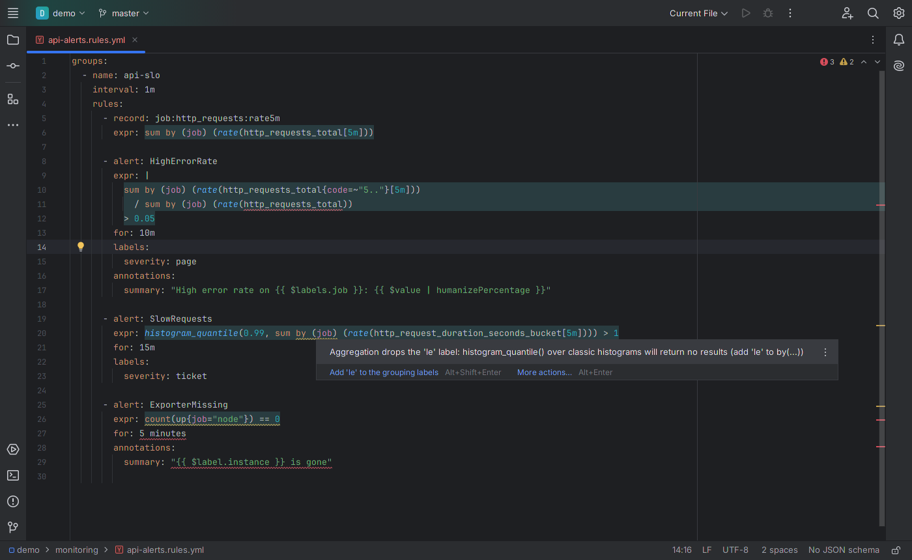
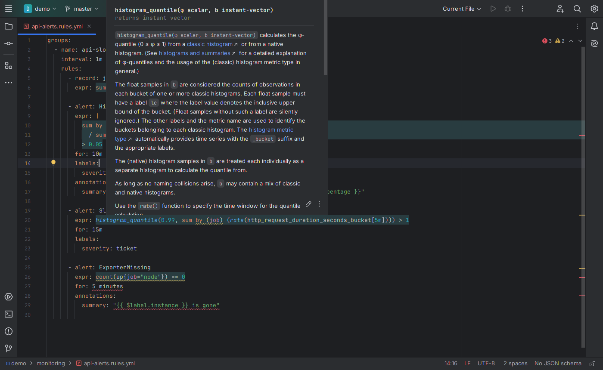

# PromQL and Prometheus Rules — JetBrains IDE plugin

Language support for **PromQL**, the Prometheus query language, in IntelliJ IDEA, GoLand, PyCharm, WebStorm and every
other JetBrains IDE (2024.3 and newer) — in `.promql` files and **inside the `expr:` of Prometheus rule files**
(alerting/recording rules, Prometheus Operator `PrometheusRule` resources, Thanos/Mimir rule files, promtool unit tests).

Install: *Settings → Plugins → Marketplace → search "PromQL"*.

## Features
- **Errors as Prometheus reports them, while you type**: parse errors, type errors (`rate(x)` without a range, range
  selectors on expressions, `sum(x[5m])`), comparisons between scalars without `bool`, wrong argument counts, invalid
  RE2 regexes (lookarounds, backreferences), repeated `offset`/`@`, `offset` on non-selectors — with quick fixes
  (add `[5m]`, convert to subquery, add `bool`, function-name typo suggestions)
- **Inspections for mistakes Prometheus accepts but that give wrong results**:
  - `histogram_quantile()` after an aggregation that drops `le` (quick fix adds it)
  - `count(...) == 0` alerts that never fire (use `absent()`)
  - `rate(sum(x)[5m:])` — counter resets are lost when aggregating first
  - `rate()`/`increase()` on gauge-like metric names
  - quantiles outside 0–1 (`99` instead of `0.99`)
  - redundant `^…$` anchors in label regexes (quick fix)
  - experimental functions and syntax that need a `--enable-feature` flag
- **Rule file checks** like `promtool check rules`: unknown fields (with "did you mean"), `record` vs `alert`, missing
  `expr`, invalid durations in `for`, `keep_firing_for`, `interval`, `query_offset`, fields not allowed in recording rules,
  invalid recording rule names, duplicate group names, undefined variables in alert templates (`{{ $label.instance }}`)
- **Completion**: functions with signatures, aggregations, keywords, durations, metric names, label names and label
  values used in the file
- **Quick documentation** (Ctrl+Q / F1) for all functions and aggregation operators (Prometheus 3.15)
- Highlighting with configurable colors (*Settings → Editor → Color Scheme → PromQL*), brace matching, commenting

Tested against the real Prometheus 3.15 parser: of 3,833 expressions from Prometheus' own test suite, kube-prometheus,
Thanos and awesome-prometheus-alerts, 3,825 get the same valid/invalid verdict from the plugin as from Prometheus (the
other 8 are edge cases of experimental syntax), and so do all of 2,986 randomly broken variants of real alert expressions.

Known limitation: an `expr:` written as a double-quoted YAML string with escapes (`"up{job=\"x\"}"`) or a single-quoted
string with `''` is not analysed (use plain, single-quoted or block scalars — as almost all rule files do).

## Source code
The plugin is closed source (free to use under the EULA); this repository hosts its documentation, license and issue
tracker. The source code is not public.

## Support
Please open an [issue](../../issues) for bugs and feature requests. Include your IDE version and a minimal query or
rule snippet (remove secrets and internal names first).

## Privacy
The plugin works fully offline and collects no data. See [PRIVACY.md](PRIVACY.md).

## License
Free to use under the [End User License Agreement](EULA.md). Third-party notice: function signatures and documentation
from Prometheus (Apache License 2.0), shipped in the plugin as `META-INF/NOTICE.txt`.

---
Independent project, not affiliated with or endorsed by the Prometheus project or The Linux Foundation. Prometheus is a
registered trademark of The Linux Foundation. JetBrains and IntelliJ are trademarks of JetBrains s.r.o.
